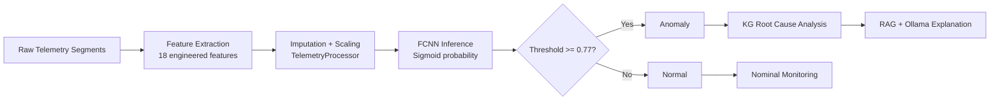
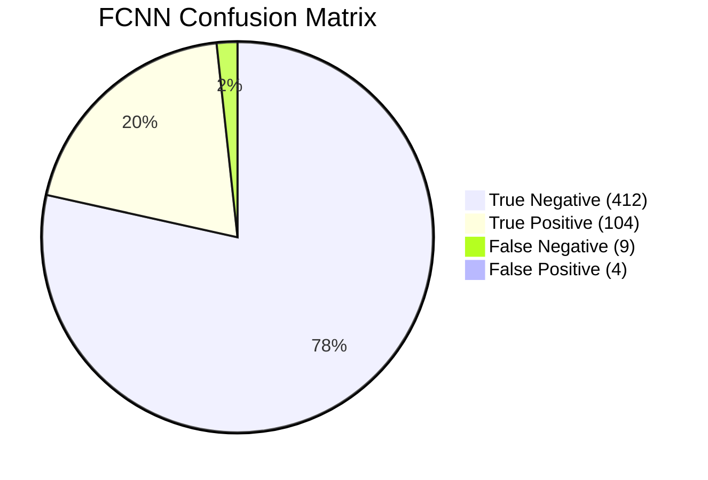
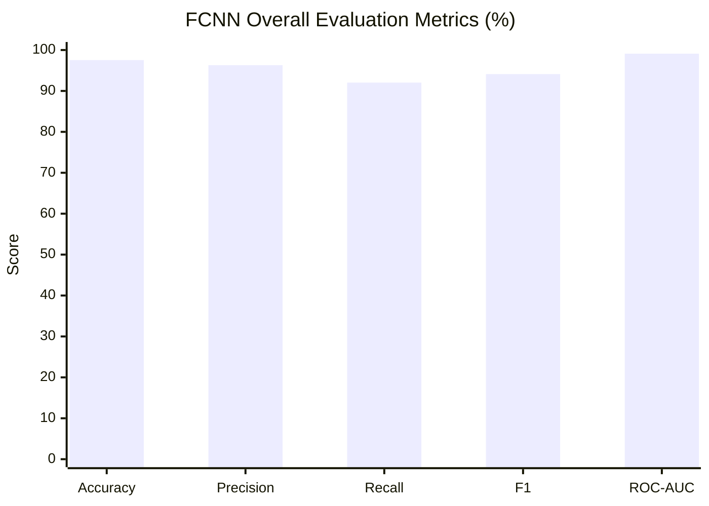
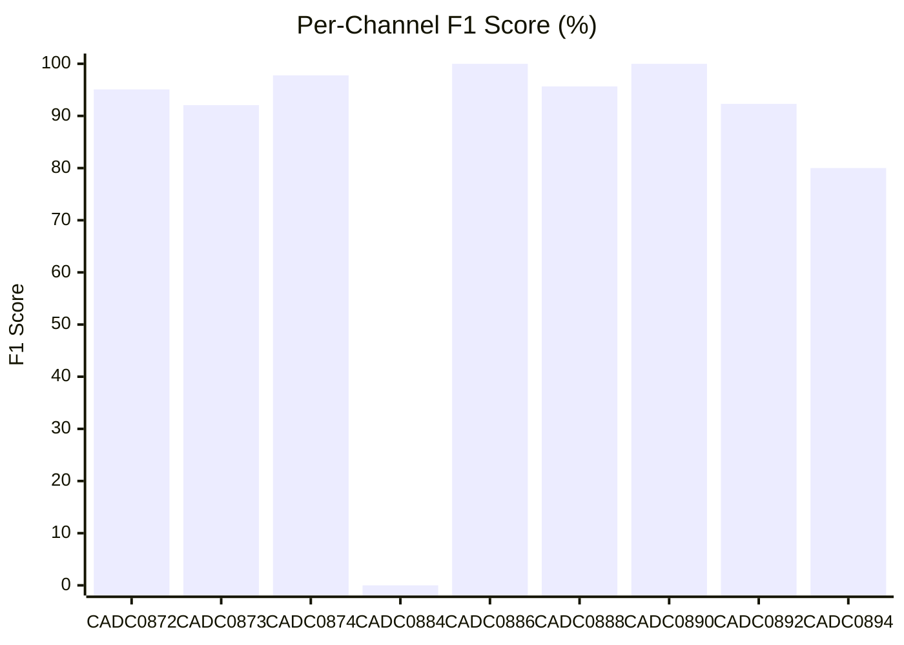
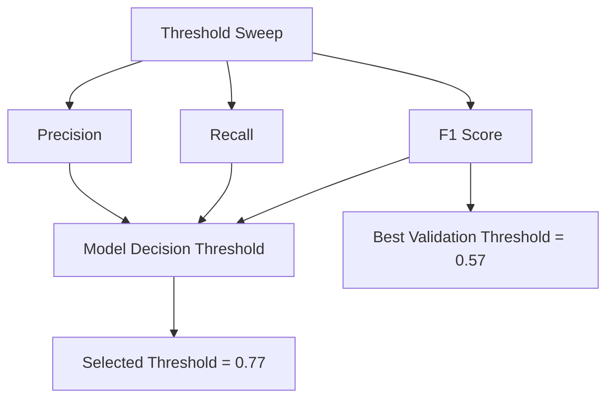

# Evaluation Metrics Diagrams

This page summarizes the FCNN evaluation results from the latest experiment and provides Mermaid diagrams you can use in the project report or documentation.

## Experiment Snapshot

- Experiment: `fcnn_phase2_20260408_014653`
- Training samples: `1275`
- Validation samples: `319`
- Test samples: `529`
- Decision threshold: `0.77`
- Validation best F1 threshold: `0.57`

## 1. Evaluation Pipeline

## 2. Confusion Matrix Summary

Overall test-set confusion matrix:
- True Negative: `412`
- False Positive: `4`
- False Negative: `9`
- True Positive: `104`

## 3. Overall Metric Comparison

## 4. Per-Channel F1 Score

## 5. Threshold Sensitivity

The evaluation found:
- Production threshold used in the model package: `0.77`
- Best threshold by validation F1: `0.57`
- Validation best F1: `0.9520`

## 6. Interpretation Notes

- High accuracy and ROC-AUC show the FCNN separates normal and anomalous telemetry well.
- Recall is slightly lower than precision, so some anomalies are still missed.
- Per-channel results show the model is strongest on magnetometer channels and some photodiode channels.
- The best validation F1 threshold is lower than the production threshold, which means the production model is tuned to be more conservative.

## 7. Source Artifacts

The generated evaluation artifacts are stored in:
- `models/experiments/fcnn_phase2_20260408_014653/evaluation/roc_curve.png`
- `models/experiments/fcnn_phase2_20260408_014653/evaluation/precision_recall_curve.png`
- `models/experiments/fcnn_phase2_20260408_014653/evaluation/confusion_matrix.png`
- `models/experiments/fcnn_phase2_20260408_014653/evaluation/threshold_curve.png`
- `models/experiments/fcnn_phase2_20260408_014653/artifacts/training_history.png`
